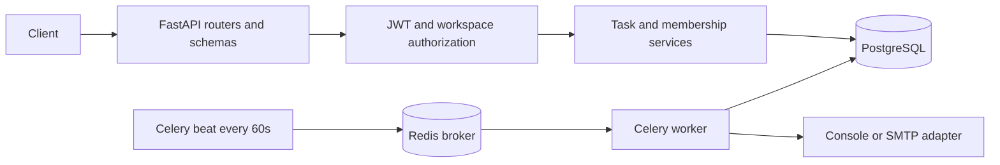

# TaskFlow API

A collaborative task management backend built with Python 3.12, FastAPI, PostgreSQL, SQLAlchemy, Redis and Celery. Users organize projects in workspaces, assign tasks, discuss work and inspect an activity history. Every resource is authorized through workspace membership.

The project now includes a responsive React/TypeScript frontend. After starting the stack, open [TaskFlow](http://127.0.0.1:3000) and choose **Explore a live demo** or create an account. The frontend supports workspace/project management, a task board and list, filtering, comments, activity, team roles, and profile settings. See [frontend setup](frontend/README.md) for development and behavior details.

Learning the project from scratch? Start with the [complete project handbook](docs/TASKFLOW_HANDBOOK.md), covering the idea, stack, code, exercises, deployment, operations, and interviews. Public deployment learning examples are in [the deployment guide](docs/deployment/README.md); they are separate from the verified local stack.

Prefer interactive diagrams? Open the [Archify learning atlas](archify-learning/index.html), with four explorable maps and a beginner walkthrough of requests, task edits, reminders, and diagram generation. The [editable guide](archify-learning/README.md) connects each map to the source code.

## Start locally

From this `BACKEND` directory, install Python 3.12+, [uv](https://docs.astral.sh/uv/getting-started/installation/) and Docker Desktop, then start the Docker engine.

```powershell
uv sync --frozen
uv run python scripts/init_env.py
docker compose up --build -d
```

Open [TaskFlow frontend](http://127.0.0.1:3000), [Swagger UI](http://127.0.0.1:8000/docs), [OpenAPI JSON](http://127.0.0.1:8000/openapi.json) or [readiness](http://127.0.0.1:8000/health/ready). Compose starts the frontend, PostgreSQL, Redis, a one-shot migration job, API, worker and one beat scheduler. Application containers run as a non-root user; database, frontend and API ports bind only to localhost. PostgreSQL data lives in the `pgdata` volume.

Run the demo against the running stack:

```powershell
uv run python scripts/demo.py
docker compose logs worker --tail=30
```

The demo creates three unique users and a workspace/project/task, adds a member and comment, updates the task, and verifies a stale write returns 409 and an outsider gets 404. It leaves its data in the development database. The task is due within 30 minutes: beat dispatches a console reminder within roughly 60 seconds. Console delivery records success without sending real email. Credentials and tokens are never printed by the demo; create your own account in Swagger to explore interactively.

To stop the services while retaining data, run `docker compose down`. Use `docker compose ps` and `docker compose logs api worker beat --tail=50` for diagnostics.

### Run the API on the host during development

```powershell
docker compose up -d db redis
uv run alembic upgrade head
uv run uvicorn app.main:app --reload
```

If the containerized API already uses port 8000, stop it with `docker compose stop api` first. The generated `.env` uses localhost for host-side development; Compose overrides service URLs to `db` and `redis` inside containers. On Windows, run Celery in Docker. For Linux/macOS host workers:

```sh
uv run celery -A app.workers.celery_app:celery_app worker --loglevel=info
uv run celery -A app.workers.celery_app:celery_app beat --loglevel=info
```

## Architecture



The modular monolith separates HTTP contracts, authorization, transactional services, persistence and background processes. Each HTTP request uses one transaction; a task change and its activity event commit together. SQLAlchemy issues an atomic `UPDATE ... WHERE version = expected_version`; exactly one competing update can win. Workspace row locks serialize membership mutations and task writes so member removal and assignment stay consistent. This favors correctness over maximum write throughput within a workspace; separate workspaces can write concurrently.

Tables: `users`, `workspaces`, `memberships`, `projects`, `tasks`, `comments`, `activity_events`, `notification_deliveries`. Composite foreign keys prevent tasks from referencing a project in another workspace or assigning a nonmember. Memberships are unique; a partial unique index permits at most one owner per workspace. The service creates the owner membership with its workspace and prevents its removal or demotion. Database timestamps use TIMESTAMPTZ; API input requires an explicit timezone.

Indexes cover project/workspace lookup, project/status, assignee/due date, project/created time, task activity and delivery dispatch. Inspect actual query plans before adding full-text search or changing indexes; no performance benchmark is claimed.

## API and permissions

All application routes begin with `/api/v1`. Register using a password of 10–128 characters, then log in with JSON email/password. Paste the returned access token into Swagger's **Authorize** dialog. Emails are normalized to lowercase and passwords use Argon2id. JWT access tokens require `sub`, `iat`, `exp`, issuer and audience and use a fixed HS256 algorithm. Tokens expire after 30 minutes by default; each request also checks the user exists and is active. There are no refresh tokens, password-reset flow or ownership transfers in v1.

| Action | Owner | Admin | Member |
| --- | --- | --- | --- |
| Read workspace, projects, tasks, stats and activity | Yes | Yes | Yes |
| Create project | Yes | Yes | No |
| Create task or comment | Yes | Yes | Yes |
| Edit task | Any | Any | Creator or assignee |
| Delete task | Any | Any | Creator only |
| Add/remove ordinary member | Yes | Yes | No |
| Grant/revoke admin role | Yes | No | No |
| Remove/demote owner or transfer ownership | No | No | No |
| Delete workspace | Yes | No | No |

Adding a member means adding an **already registered user by UUID**, as specified by the guide's members endpoint. Email invitation links and acceptance tokens are not implemented. Removing a member clears their task assignments and increments those task versions in the same transaction. The creator remains for attribution; a removed creator cannot access the workspace. Any member may assign an editable task to another workspace member. All four documented task statuses may transition to one another, including reopening done tasks.

Nonmembers receive 404 for resource access; members without a required role receive 403. Missing/invalid/expired tokens return 401. Invalid input returns 422. Duplicates, stale versions and conflicting database references return 409. Login is limited to 10 requests per client IP per 60 seconds through shared Redis counters; if Redis is unavailable login returns 503. Proxy headers are disabled by default to prevent client IP spoofing. Configure a trusted proxy explicitly if deploying behind one.

| Method | Route | Purpose |
| --- | --- | --- |
| POST | `/auth/register`, `/auth/login` | Register or obtain access token |
| GET / PATCH | `/users/me` | Read profile or change full name |
| POST / GET | `/workspaces` | Create or list authorized workspaces |
| GET / DELETE | `/workspaces/{id}` | Read or owner-delete workspace |
| GET / POST | `/workspaces/{id}/members` | List or add members |
| PATCH / DELETE | `/workspaces/{id}/members/{user_id}` | Change role or remove member |
| POST / GET | `/workspaces/{id}/projects` | Create or list projects |
| GET | `/workspaces/{id}/stats` | Counts by status and overdue count |
| GET | `/workspaces/{id}/activity` | Workspace audit feed including deleted tasks |
| POST / GET | `/projects/{id}/tasks` | Create or query tasks |
| GET / PATCH / DELETE | `/tasks/{id}` | Read, versioned update or delete |
| POST / GET | `/tasks/{id}/comments` | Add or list comments |
| GET | `/tasks/{id}/activity` | Read task audit feed |

List endpoints return `{items, total, limit, offset}` except the members endpoint, which returns an array. Default limit is 20, maximum 100. Task queries support `status`, `priority`, `assignee_id`, literal case-insensitive `q` search over title/description and `sort`. Sort values: `created_at`, `-created_at`, `due_at`, `-due_at`, `priority`, `-priority`. Priority sorts by low/medium/high/urgent rank; missing due dates sort last. UUID breaks ties deterministically. Offset pagination suits v1; keyset pagination and PostgreSQL full-text search are future options.

Example PATCH body:

```json
{
  "expected_version": 1,
  "status": "in_progress",
  "assignee_id": null
}
```

Omitted fields are unchanged. Explicit `null` clears only `assignee_id` or `due_at`. A successful update increments `version`; fetch again after a 409. At least one changed field is required. Title length is 1–200; descriptions and comments are limited to 10,000 characters. Task deletion cascades to comments and reminders. Activity records have no edit/delete API; task deletion nulls their foreign key while a deletion event retains the task UUID. Workspace deletion cascades its entire history. User deletion is restricted by attribution foreign keys.

## Reminders

Beat runs one scanner every minute. Tasks that are due within an hour or already overdue and are not done get one reminder per `(task, recipient, kind, due_at)`. Recipient is the current assignee, or creator if unassigned. The database retains a dispatch record before enqueueing. Five-minute queue leases allow another scan to recover an interrupted publisher or lost queue message. Workers lock the delivery row, recheck task status/due date/recipient, then record sent, cancelled, retryable pending, or terminal failed state. Retry delays start at 30 seconds and double; at most five send attempts are recorded. A changed due date or assignment invalidates stale queued deliveries.

Delivery is **at least once**. The database transaction and external email side effect cannot commit atomically: a crash after SMTP accepts a message but before DB commit can send it again. A stable Message-ID aids tracing but does not promise exactly-once SMTP delivery. A provider with idempotency keys can improve this. Failed deliveries remain available for operator inspection; there is no public delivery administration API. A task reopened with the same due date does not resend an already delivered reminder. The v1 scanner may examine many due tasks; paginate/retain history and measure plans before operating at scale.

For real mail set `EMAIL_BACKEND=smtp`, `EMAIL_FROM`, `SMTP_HOST`, `SMTP_PORT`, `SMTP_STARTTLS`, and optionally `SMTP_USERNAME`/`SMTP_PASSWORD`. Only console delivery is exercised by the local demo; tests inject failing and successful email adapters.

## Tests and CI

Tests use real PostgreSQL, a dedicated database ending in `_test`, and Redis database 15. They truncate application tables between tests. The test guard rejects a non-test database name. Create the database once:

```powershell
docker compose up -d db redis
docker compose exec -T db createdb -U taskflow taskflow_test
uv run ruff check .
uv run ruff format --check .
uv run pytest -q
uv run alembic check
```

The `createdb` command reports an error if the test database already exists; proceed with tests in that case. Override `TEST_DATABASE_URL` and `TEST_REDIS_URL` for another dedicated test stack. Tests cover auth and validation, expired/deleted/disabled users, role restrictions, cross-workspace ID guessing, filters, pagination, null updates, real concurrent writes, transaction rollback, database foreign keys/uniqueness, reminders and Redis login throttling. Test schema is created through Alembic, never production `create_all()`.

The GitHub Actions workflow is at `../.github/workflows/taskflow-ci.yml`, the root of the surrounding DSA_DOJO repository. It provisions PostgreSQL/Redis, applies migrations, checks model/migration drift, runs lint/format/tests and builds the Docker image. If you extract BACKEND into its own repository, move that workflow into its root `.github/workflows` and remove the `BACKEND` working-directory and path prefixes.

## Configuration and deployment

| Variable | Default / requirement |
| --- | --- |
| `DATABASE_URL` | Async SQLAlchemy PostgreSQL URL; local default in `.env.example` |
| `JWT_SECRET` | Required, at least 32 characters; `init_env.py` generates a random secret |
| `ACCESS_TOKEN_EXPIRE_MINUTES` | 30, maximum 1440 |
| `REDIS_URL` | Local Redis DB 0; tests use DB 15 |
| `CORS_ORIGINS` | JSON array of explicit frontend origins |
| `ENVIRONMENT` | development, test or production |
| `EMAIL_BACKEND` | console or smtp |
| `EMAIL_FROM`, `SMTP_*` | Email transport configuration described above |
| `LOGIN_LIMIT`, `LOGIN_WINDOW_SECONDS` | 10 requests / 60 seconds |

The Docker Compose file is for local development and contains a documented development database password. For deployment, use the same Dockerfile for an API service, worker service and exactly one beat instance, with managed PostgreSQL 16+ and Redis. Supply service credentials through the hosting provider's secret manager. Set `ENVIRONMENT=production` and a generated JWT secret, explicit CORS origins and SMTP settings. Run `alembic upgrade head` once as a release job before starting new app replicas; the image deliberately does not run migrations on each API startup. Configure HTTPS, private database/broker networking, backups and log aggregation. Use `/health` for liveness and `/health/ready` for database/schema/Redis readiness. Configure trusted proxy IPs when enabling forwarded headers, or login throttling will see the proxy IP.

This repository provides a verified local stack and deployment artifacts. No cloud resource or public deployment is created automatically. Public deployment and real SMTP delivery require the target provider and credentials. Sessions, email verification, password reset, refresh-token revocation, full-text search and real-time collaboration are future work. JWTs were chosen for a simple independent API; server-side sessions offer easier immediate token revocation. The modular monolith keeps transactions and deployment understandable for this project.

Implementation references: [FastAPI](https://fastapi.tiangolo.com/tutorial/), [SQLAlchemy version counters](https://docs.sqlalchemy.org/en/20/orm/versioning.html), [Celery task delivery and retries](https://docs.celeryq.dev/en/stable/userguide/tasks.html), [Alembic](https://alembic.sqlalchemy.org/en/latest/).
