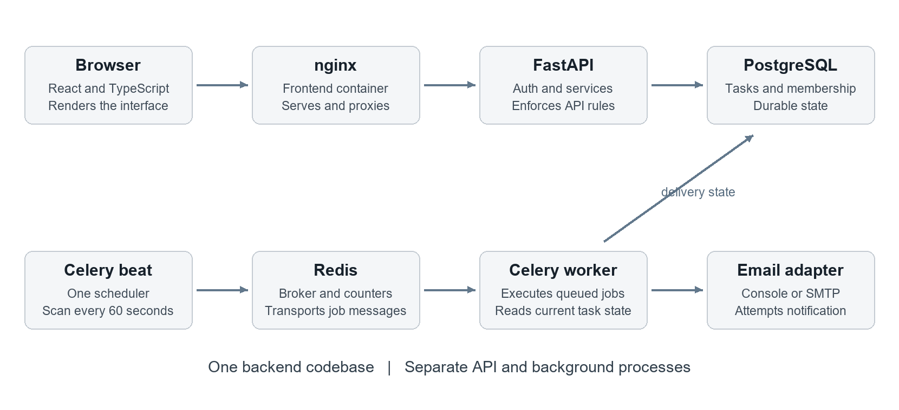

# TaskFlow Project Handbook

## From first concepts to development deployment and interviews

Prepared for a beginner learning the existing TaskFlow project. Repository reviewed on 22 October 2026. Commands are labeled for Windows PowerShell or a Linux deployment server.

This handbook teaches you how the application works, how to change it safely, how to prepare a public deployment, and how to explain its engineering decisions in an interview. You already have working code. Your next job is to understand it well enough to trace a request, reproduce a failure, improve a feature, and defend the trade-offs.

The application has been built and exercised locally. Earlier verification in this chat recorded 62 passing backend integration tests, successful frontend production builds, browser task and comment flows, and a console reminder delivered by Celery. These are observations from that verification, not a promise that every future change will pass. No public deployment or real SMTP delivery has been completed.

Read chapters 1 through 8 before trying to memorize interview answers. Then follow the implementation sequence and exercises. Treat deployment as a separate release with its own checks. The final interview chapters help you explain evidence you can demonstrate.

## Contents

1. Understand the product and its scope
2. Learn the minimum technical vocabulary
3. Understand the technology choices
4. Read the architecture as a request journey
5. Start the application on Windows
6. Find your way around the repository
7. Understand the database design
8. Understand authentication and workspace permissions
9. Follow a task update from click to commit
10. Understand the frontend and its state
11. Understand reminders and background work
12. Learn the API through a practical walkthrough
13. Rebuild the project in a sensible order
14. Make your first independent feature change
15. Test the behaviors that matter
16. Work with Git and continuous integration
17. Prepare a public deployment
18. Deploy the provided Linux server example
19. Operate and recover the application
20. Debug common failures systematically
21. Explain the project in an interview
22. Practice technical interview questions
23. Prepare a portfolio and resume with evidence
24. Follow a study plan and assess your readiness
25. Use the reference material

# 1 Understand the product and its scope

## The problem you are solving

A small team needs to know what work exists, who owns it, when it is due, and what has changed. A spreadsheet can capture task names, but it does not automatically enforce access rules, detect conflicting edits, record a transactionally consistent history, or retry failed reminders.

TaskFlow gives each team a workspace. A workspace contains projects. A project contains tasks. A task can be assigned to a workspace member and can have a description, due date, priority, status, comments, and activity events.

Imagine a student team launching a website. The team creates a workspace named Design Club and a project named Website Launch. One member creates Design the homepage, assigns it to another member, and sets a due date. The assignee moves the task from To do to In progress. A comment records a design question. The owner sees the change in activity. A person outside the workspace cannot read the task even if they know its UUID.

## Your product requirements

- A user can register, sign in, and update their own display name.
- A user can create a workspace and become its owner.
- Owners and admins can add already registered users by user ID, subject to role restrictions.
- Owners and admins can create projects. Workspace members can create tasks.
- The creator, assignee, owner, or admin can edit a task. Members can delete only tasks they created.
- Task changes produce activity events within the same database transaction.
- A stale task update receives a conflict response instead of silently overwriting a newer change.
- Background processes discover due work, queue reminders, retry transient failures, and record outcomes.
- The frontend exposes these workflows through a responsive board, list, dialogs, and team screens.

## Scope that keeps the project achievable

This version is a modular monolith: one backend codebase with multiple modules. API, worker, and scheduler run as different processes but share models and configuration. You do not need Kubernetes or microservices to explain this design.

Email invitation links, password reset, refresh tokens, ownership transfer, file uploads, real-time collaboration, billing, and full-text search are outside the current implementation. Membership is added by registered user ID. The frontend shows another member's abbreviated ID because the membership API does not return that person's private profile.

## How you measure completion

A feature is complete when its allowed user can perform it, its disallowed user cannot, the data is persisted correctly, failures are understandable, and you have evidence from the right layer. A pretty button without a working API request is incomplete. An API response without the expected database change is also incomplete.

Practice: explain the product to a nontechnical friend in four sentences. Then create one workspace and one project in the running app. Write down which user owns the workspace and who can create another project.

# 2 Learn the minimum technical vocabulary

## What happens on the web

The frontend is the application running in the browser. It renders forms, buttons, task cards, and feedback. The backend is a server that accepts requests, checks rules, and reads or changes stored data. PostgreSQL is the durable database. The browser does not connect directly to PostgreSQL.

HTTP is the request and response protocol. A method such as GET or POST describes the operation. A URL identifies the resource. A JSON body carries structured input. A status code summarizes the result. A response body carries the result or an error explanation.

For example, POST /api/v1/projects/{id}/tasks sends a task description to the server. A successful request returns status 201 and the created task. The browser then refreshes its task data and renders a new card.

## Terms you will use every day

| Term | Plain explanation | TaskFlow example |
| --- | --- | --- |
| API | A defined interface for another program | A route that returns a project's tasks |
| Endpoint | One method and URL combination | PATCH /api/v1/tasks/{id} |
| JSON | A text format for objects and lists | A body containing title and status |
| Schema | Rules describing a data shape | Title must have 1 to 200 characters |
| Model | A representation of a database table | Task in app/models/__init__.py |
| ORM | A library mapping Python operations to SQL | SQLAlchemy |
| Migration | A versioned database structure change | The initial Alembic revision |
| Transaction | A group of changes committed together | Update a task and append its event |
| Authentication | Establishing which user is calling | Validate a bearer token |
| Authorization | Deciding what that user may do | Check workspace membership |
| Tenant | An isolated customer or team boundary | A workspace |
| Queue | Work waiting for a worker | Reminder delivery IDs in Redis |
| Container | An isolated process environment | The API Docker container |
| Reverse proxy | A server forwarding requests | nginx forwards /api to FastAPI |
| CI | Automated checks after a code change | GitHub Actions runs pytest |

## Concepts that sound similar but are different

A Python type hint describes an expected type to tools and readers. Pydantic performs runtime validation on incoming data. A database constraint protects stored relationships even when a caller bypasses the normal HTTP path. A professional implementation uses these at their respective boundaries.

Async I/O lets Python await slow I/O without blocking the event loop. It does not make CPU-heavy password hashing free or turn one database into unlimited capacity. TaskFlow moves hashing and verification to a thread pool and awaits database operations through an async driver.

An image is the packaged filesystem and startup definition used by Docker. A container is a running instance of that image. A volume stores data outside a container's disposable filesystem. Replacing an API container does not normally erase the PostgreSQL volume.

Practice: point at the browser, API container, Redis container, worker, and database in docker compose ps. Explain one sentence about the responsibility of each.

# 3 Understand the technology choices

## The actual stack in this repository

The table describes the implementation family, not a claim that every package is the newest release. Backend exact versions are pinned in uv.lock. Frontend exact versions are pinned in frontend/package-lock.json. Keep those lockfiles when reproducing the project.

| Layer | Technology | Why it is here |
| --- | --- | --- |
| Backend language | Python 3.12 or later | Readable service code and modern typing |
| HTTP framework | FastAPI with Pydantic v2 | Validated contracts and generated OpenAPI |
| HTTP server | Uvicorn | Runs the Python ASGI application |
| Database | PostgreSQL 16 container | Relationships, transactions, locks, and indexes |
| Persistence | SQLAlchemy 2.x and asyncpg | Explicit SQL modeling with async database I/O |
| Schema evolution | Alembic | Reviewable versioned migrations |
| Password storage | Argon2id through pwdlib | Password verification without storing plaintext |
| Access tokens | PyJWT with fixed HS256 | Signed, expiring bearer credentials |
| Broker and counters | Redis | Celery transport and shared login throttling |
| Background jobs | Celery worker and beat | Scheduled scans and retryable reminder work |
| Frontend | React and TypeScript | Components and checked client data contracts |
| Frontend build | Vite | Local development and production asset builds |
| API state | TanStack Query | Cached requests, refresh, and invalidation |
| Frontend serving | Unprivileged nginx | Static assets and same-origin API proxying |
| Tests and style | pytest, httpx, Ruff | Behavior checks and consistent Python code |
| Packaging and CI | Docker Compose and GitHub Actions | Reproducible processes and automated checks |

## The decisions you should be able to defend

PostgreSQL fits because workspaces, memberships, projects, tasks, and users have meaningful relationships. A composite foreign key can reject an assignee from the wrong workspace. A document database could work, but you would need to redesign those invariants and justify the change.

FastAPI fits typed JSON APIs and exposes interactive documentation. It does not automatically design your permission rules or transaction boundaries. Those are explicit service and dependency responsibilities in this project.

React components make the UI easier to split by responsibility. TypeScript catches many wrong client data shapes during the build, but the backend still validates every request at runtime.

Redis is not the primary task database. If Redis is unavailable, existing tasks remain in PostgreSQL, while login throttling and queue dispatch may be unavailable. The application's login limiter intentionally fails closed with 503 when Redis cannot be reached.

Celery is useful because reminder delivery has a separate schedule and failure lifecycle. A simple synchronous email call inside task creation would delay the request and tie email availability to the user's edit. Celery brings additional services and operational work, so explain the reliability behavior rather than calling the stack inherently scalable.

Practice: choose one technology and name one alternative, the benefit of that alternative, and the new complexity it would introduce. Do not claim a technology is always better.

# 4 Read the architecture as a request journey



## The browser path

In the local production-style stack, the browser opens http://127.0.0.1:3000. nginx serves the compiled React application. When the application requests /api/v1/workspaces, nginx forwards it to the API service at api:8000. The user sees one origin, so this browser flow does not require a permissive CORS policy.

The API validates the request, resolves the current user, checks resource membership, and calls a service. The service executes SQLAlchemy operations in a request-scoped session. The transaction commits before the response is sent by the function-scoped database dependency.

The frontend receives JSON and displays it. After a successful mutation, related TanStack Query data is invalidated and fetched again. That is why the card count and activity feed can reflect a saved change.

## The reminder path

Celery beat submits a scan job every 60 seconds through Redis. A worker executes the scan, finds eligible tasks in PostgreSQL, and creates durable delivery records. The scanner claims eligible delivery IDs and queues delivery jobs. A worker later locks a delivery, checks whether it is still relevant, invokes the email adapter, and records the outcome.

Beat schedules work; it does not itself render the frontend or serve API requests. Redis transports queue messages. PostgreSQL holds the authoritative tasks and delivery records. These responsibilities are separate even though the code lives in one repository.

## Why this is still a monolith

Running several containers does not automatically create microservices. The API, worker, and scheduler share one domain model and one database schema. A backend change can require deploying several of those processes together. That is an intentional trade-off for a project of this size.

The current code also has no separate repository abstraction layer. Service and route modules issue SQLAlchemy queries directly. Describe the actual architecture as routers, dependencies, services, and persistence models; do not invent a repository layer because another diagram or tutorial used one.

Practice: trace GET /api/v1/tasks/{id}. Find the route, task_access, membership join, session dependency, read schema, and frontend request. Draw the journey from memory.

# 5 Start the application on Windows

## Understand where commands run

Run the following commands from Windows PowerShell in the BACKEND directory. A directory matters because Compose, Python, and package tools look for configuration relative to the current location.

```powershell
Set-Location 'C:\Users\chara\OneDrive\Documents\GitHub\DSA_DOJO\BACKEND'
Get-Location
```

Install Git, Docker Desktop, Python 3.12 or later, and uv if missing. Start Docker Desktop and use Linux containers. Node 22 or later is needed for host frontend development; the Docker frontend build supplies its own Node environment.

```powershell
git --version
docker version
docker compose version
uv --version
```

Expected: Docker lists a responding server. A client version without a working server means the engine has not started. Follow each tool's official installation instructions rather than downloading an unfamiliar installer.

## The first complete startup

```powershell
uv sync --frozen
uv run python scripts/init_env.py
docker compose up --build -d
docker compose ps
```

uv sync installs the versions in uv.lock into .venv. init_env.py creates .env with a generated JWT secret and preserves an existing .env. Compose builds images, starts database and Redis, runs migrations, and starts the API, worker, beat, and frontend. The first image downloads can take time.

Open http://127.0.0.1:3000 for the frontend. Open http://127.0.0.1:8000/docs for Swagger. GET /health should report ok; GET /health/ready checks database/schema access and Redis and should report ready. A container can be running before its health check has succeeded.

Choose Explore a live demo to get a unique account, workspace, two projects, and nine persisted tasks. Create a normal account if you want credentials you can use later. Demo passwords are random and not displayed; the demo's bearer token lasts for that browser session until expiry.

## Your first manual tour

1. Open the demo board and identify the four statuses.
2. Create a task with a title and description. Confirm the count increases.
3. Open it, change status, and save. Notice its version changes.
4. Add a comment and inspect task activity.
5. Open Team members and your profile. Find your user ID.
6. Create a second normal account in another browser session and add it as a member by ID.
7. Confirm the second account can read the workspace but cannot create a project as a member.

## Stop and restart without losing your work

```powershell
docker compose down
docker compose up -d
```

The named database volume retains data. Do not add -v to down unless you intentionally want to remove the associated named volumes. A container restart and a database reset are different operations.

Checkpoint: you can start from a terminal, find the frontend, explain why migration runs before the API, and restart without losing a test task.

# 6 Find your way around the repository

## Backend files to read first

Start with app/main.py. It creates FastAPI, registers routers and error handlers, configures CORS, and defines health checks. Then read app/core/config.py to see settings and production validation. Read app/db/session.py to understand how a session is created and committed or rolled back.

Continue with app/api/dependencies.py. DB is the reusable session dependency. current_user reads the bearer token, validates it, loads the user, and rejects a missing or inactive account. CurrentUser is reused by protected endpoints.

Read app/models/__init__.py for actual tables and constraints, then app/schemas/__init__.py for create, update, and read contracts. A schema and a model serve different boundaries; do not merge them simply because they share field names.

The route modules are app/api/v1/auth.py, workspaces.py, projects.py, and tasks.py. Domain behavior is concentrated in app/services/auth.py, permissions.py, tasks.py, and notifications.py. Some small workspace and project operations are implemented directly in route modules; this is a modest layered design rather than a rigid architecture framework.

Read app/workers/celery_app.py for broker configuration and beat schedule. Read app/workers/reminders.py for Celery entry points and their async database bridge.

## Frontend files to read next

frontend/src/main.tsx creates the React application and QueryClient. App.tsx handles authentication state, workspace/project selection, navigation, board/list rendering, filters, and creation dialogs. It is deliberately an application shell, but it has grown large; splitting it further is a reasonable refactor once you understand its state.

api.ts wraps fetch, attaches the bearer token, interprets errors, clears expired sessions, and retrieves all API pages when needed. types.ts describes data received from the backend. Auth.tsx handles sign-in and registration; demo.ts creates real sample records.

TaskPanel.tsx contains task editing, version conflicts, comments, and activity. Team.tsx manages role-aware member operations. ui.tsx contains shared dialogs, feedback, buttons, and helpers. styles.css holds responsive styles. nginx.conf is used by the production frontend container; vite.config.ts configures the development proxy.

## Operational files

Dockerfile packages the backend. frontend/Dockerfile builds and serves the browser app. compose.yaml describes local services. alembic/versions contains schema history. Tests live in tests/. The workflow is at ../.github/workflows/taskflow-ci.yml because BACKEND is inside the surrounding DSA_DOJO Git repository.

Practice: use your editor's search to find expected_version, workspace_access, schedule_reminders, and taskflow:expired. For each, write down where the input comes from and what happens next.

# 7 Understand the database design

## The main relationships

One user can belong to many workspaces. One workspace can contain many users. Membership is the join table that turns this many-to-many relationship into two ordinary relationships and adds a role.

A workspace owns many projects. A project owns many tasks. A task has one creator and an optional assignee. A task can have many comments, activity events, and notification delivery records. User IDs are UUIDs, but a UUID is an identifier rather than permission to access a row.

| Table | Main responsibility | Important rule |
| --- | --- | --- |
| users | Identity and password hash | Normalized email is unique |
| workspaces | Team boundary | owner_id references an existing user |
| memberships | User role inside a workspace | Composite primary key prevents duplicates |
| projects | Group related tasks | Workspace reference must exist |
| tasks | Work items and versions | Project and assignee must match the workspace |
| comments | Discussion attached to a task | Task and author references must exist |
| activity_events | Recorded changes | No mutation API; task deletion nulls task reference |
| notification_deliveries | Reminder lifecycle | Composite deduplication key is unique |

## Why composite foreign keys matter

Task has project_id and workspace_id. The pair references the matching pair on projects. That rejects a task which claims one workspace while pointing at a project in another.

Task also has workspace_id and optional assignee_id. The pair references memberships. That rejects assigning a user who exists globally but is not a member of this workspace. Application validation produces a useful 422, while the constraint protects the stored invariant if a different writer bypasses that validation.

Membership's primary key is workspace_id plus user_id. It prevents two membership rows for the same pair. A partial unique index permits at most one membership with role owner in a workspace. The service creates the owner membership in the workspace transaction and prevents owner demotion/removal. The database does not by itself guarantee every workspace always has exactly one owner membership under arbitrary direct SQL; that part is maintained by the application workflow.

## Deletion and history

Deleting a task removes its comments and reminders. Activity keeps a deletion event containing the task UUID and title, while the task_id reference is set to null. Deleting the entire workspace removes that workspace's history. Activity is therefore an application audit history with explicit retention behavior, not a tamper-proof compliance ledger.

Removing a member clears their assignments, increments affected task versions, records unassignment activity, and then removes membership in one transaction. Users referenced by historical authorship are protected by restrictive foreign keys.

## Indexes and migrations

An index is an additional lookup structure that can accelerate a matching query, at the cost of storage and write overhead. TaskFlow indexes workspace/project lookup, project/status, assignee/due date, project creation order, task activity, and pending delivery dispatch. An index does not mean a query has been benchmarked.

Alembic records schema revisions. Run alembic upgrade head to apply missing revisions. Review generated migrations before committing them, especially constraints, nullable columns, and deletion behavior. The production strategy is migration history, not create_all at application startup.

Practice: in app/models/__init__.py, locate the two composite task foreign keys. Explain which invalid row each would reject. Then read the corresponding initial migration and find the same constraints.

# 8 Understand authentication and workspace permissions

## Registration and password verification

Registration validates email, password length, and full name. The service normalizes the email to lowercase and stores an Argon2id hash. A hash is a password verification artifact, not a recoverable encrypted password. A duplicate email returns 409.

Login looks up the normalized email and verifies the hash. Unknown accounts and wrong passwords receive the same generic 401 message. A dummy hash verification reduces the obvious timing difference for an unknown email. CPU-intensive hashing and verification run in a thread pool instead of blocking the async event loop.

Redis counts login attempts per client IP in a shared time window. The increment and TTL initialization happen atomically in a Lua script. Defaults are 10 login requests per 60 seconds. This is a basic login control, not a complete abuse prevention system; registration and password reset protection would need additional design.

## What the token actually proves

The access token contains sub, iat, exp, iss, and aud. sub identifies the user; exp limits validity; issuer and audience restrict intended use. Verification fixes the allowed algorithm to HS256 and validates signature and required claims. JWT contents are readable by the holder; signing protects authenticity, not secrecy.

Every protected request also loads the user and checks is_active. The current application has no public disable-user administration endpoint, no refresh tokens, and no token revocation list. Frontend logout clears the browser token; a copied token can remain valid until expiry unless the underlying user becomes inactive or verification no longer accepts its signature.

## Workspace roles

| Action | Owner | Admin | Member |
| --- | --- | --- | --- |
| Read workspace data | Yes | Yes | Yes |
| Create projects | Yes | Yes | No |
| Create tasks and comments | Yes | Yes | Yes |
| Edit tasks | Any | Any | Creator or assignee |
| Delete tasks | Any | Any | Creator only |
| Add or remove ordinary members | Yes | Yes | No |
| Grant or revoke admin | Yes | No | No |
| Remove or demote the owner | No | No | No |
| Delete the workspace | Yes | No | No |

Permissions are scoped per workspace. Being an admin in Workspace A does not make you an admin in Workspace B. A resource query joins through membership rather than trusting a workspace ID sent by the browser. Inaccessible resources return 404 to avoid confirming their existence; known members without a required role receive 403.

Frontend role checks make the UI understandable, but API checks are authoritative. Hiding a button does not prevent someone from sending an HTTP request directly.

Practice: create two accounts and two workspaces. Test reading another workspace's task by UUID with the wrong token. Then add the second user as a member and compare reading with project creation.

# 9 Follow a task update from click to commit

## The normal path

1. TaskPanel holds the task snapshot, including version, that the user opened.
2. The form submits editable fields and expected_version through api.ts.
3. The PATCH route validates TaskUpdate and resolves CurrentUser and DB.
4. The service finds the task through workspace membership.
5. It locks the workspace row and repeats authorization after waiting.
6. It validates any new assignee against workspace membership.
7. It executes an update conditioned on the expected version.
8. It appends an activity event in the same session.
9. The request transaction commits, and the API returns the refreshed task.
10. The frontend refreshes affected queries and shows success.

The second authorization check matters. A member might be removed while their request waits for the workspace lock. A pre-lock membership check alone would allow an old authorization decision to survive that removal. There is an integration regression test for this sequence.

## The SQL idea behind optimistic locking

```sql
UPDATE tasks
SET title = :new_title,
    version = version + 1,
    updated_at = :now
WHERE id = :task_id
  AND version = :expected_version;
```

Suppose Alex and Priya both open version 4. Alex saves successfully and the row becomes version 5. Priya's request still expects 4, so its update affects zero rows. TaskFlow returns 409 and does not append a successful task.updated event for that failed write.

The browser preserves the stale draft and offers Load latest version. That action intentionally replaces the editor snapshot with the latest server data. Automatically retrying the same full form using the new version could overwrite someone else's work, so the user must review the latest version before saving again.

The code uses an explicit version predicate. SQLAlchemy's ORM version-counter documentation describes a related pattern, but this implementation does not configure version_id_col on the Task mapper. [SQLAlchemy versioning reference](https://docs.sqlalchemy.org/en/20/orm/versioning.html)

## Transactions and partial changes

flush sends pending changes to the database inside the current transaction. It does not make the transaction permanently committed. commit finalizes it. rollback abandons its uncommitted changes.

TaskFlow commits the task edit and activity event together. If an event insertion fails before commit, the edit must roll back too. Otherwise the task and its recorded history would disagree. tests/test_database.py includes a rollback check for this relationship.

## The coordination cost in this implementation

Workspace row locks simplify member removal versus task assignment and task mutation races. They also serialize task writes inside one workspace. The version predicate still rejects stale client snapshots, while the workspace lock is a broader coordination mechanism. This is a sensible correctness-first implementation with a throughput cost; it is not a lock-free update system.

Practice: run the concurrency tests. Explain why two requests with the same expected version produce one 200 and one 409, even if the database processes them sequentially after lock contention.

# 10 Understand the frontend and its state

## Three categories of state

Server state is information owned by the API: users, workspaces, projects, tasks, comments, members, and activity. TanStack Query loads and caches it. Local UI state includes the selected tab, search text, open dialog, and unsaved form fields. Session state includes the bearer token and the user's selected workspace/project stored for the current browser session.

Mixing these categories creates confusing bugs. A task edited only in React state disappears after reload. A dialog flag stored as if it were server data makes navigation harder to reason about. TaskFlow sends mutations to the backend and refreshes relevant query data afterward.

## The request wrapper

api.ts prefixes /api/v1, attaches Authorization when a token exists, parses JSON, and converts failed responses into ApiError. It handles 204 without trying to parse an empty JSON response. On a protected 401 it clears the session and emits the event that returns the app to sign-in.

Tokens are stored in sessionStorage in this version. That makes them available to JavaScript in the page and keeps them scoped to the browser session. An HTTP-only cookie approach would require backend authentication changes and an explicit CSRF strategy. Do not describe the current app as using HTTP-only cookies.

## Board data and filters

The frontend retrieves all API pages for the selected project, then filters and sorts the loaded tasks locally. The table displays ten rows per client page. The backend separately supports server-side query filters and bounded pages. Current frontend pagination therefore reduces visible rows, not the total data downloaded.

This makes modest project boards convenient, but a large workspace needs server-driven filtering/pagination or a deliberate board-fetch strategy, plus possible virtualization. Do not claim that the current frontend is already optimized for millions of tasks.

## Forms and feedback

Input names and TypeScript shapes must match the backend request contract. Task forms distinguish a missing due date from a local datetime value; the client converts the latter to an ISO timestamp. Read-only and role-aware UI controls reduce mistakes, while backend permissions still enforce rules.

Dialogs have accessible names, keyboard dismissal, and focus restoration. Narrow screens use a two-column board and hidden navigation becomes inert until opened. Drag-and-drop has alternatives: open a task to edit status, use the table status selector, or use complete/reopen.

Practice: open browser network tools and create one task. Identify the request URL, method, JSON, Authorization header presence, response code, returned version, and the following refetch. Do not paste tokens into screenshots or a portfolio.

# 11 Understand reminders and background work

## The delivery lifecycle

A scan runs every minute. It considers unfinished tasks due within one hour or already overdue. The current assignee receives the reminder; if the task is unassigned, its creator is used. A delivery's unique key includes task, recipient, kind, and due_at stored as scheduled_for.

Here scheduled_for identifies the task's due-date occurrence. It is not a promise to send exactly at that timestamp: the scanner intentionally starts considering the task one hour before it is due.

Eligible delivery records become queued with a five-minute lease. Delivery jobs carry IDs, not a stale copy of the whole task. The worker loads current data before sending. If status becomes done, due date changes, or recipient changes, the old delivery can be cancelled.

## Why there is a database record and a queue message

PostgreSQL stores durable intent and outcome. Redis carries the work message. Committing a row and publishing a broker message are different operations. If the process dies between them, a lease-expiry scan can claim and publish the delivery again.

The design is similar to a small database-backed dispatch/outbox mechanism, but it does not make the broker and database one atomic system. Queued records can be published more than once. A row lock and sent-state checks reduce simultaneous duplicate processing.

## Retry behavior and its limits

For a transient SMTP or network error, the worker records an attempt and a short error class, schedules a later attempt, and uses Celery retry. Delays start at 30 seconds and double. The service records at most five send attempts before terminal failed status. A stable Message-ID helps tracing but is not a guaranteed SMTP idempotency key.

There remains a crash window after the email provider accepts a message and before PostgreSQL records success. A retry can send again. Explain the processing as at-least-once with deduplication safeguards, not exactly-once email delivery. Celery likewise documents why task idempotency matters. [Celery task reference](https://docs.celeryq.dev/en/stable/userguide/tasks.html)

Console mode logs a delivery ID and records success without contacting an email provider. SMTP mode requires credentials, a sender address, and a reachable mail server. Successful console delivery is not proof of an email reaching an inbox.

## Important implementation details

The Celery bridge creates an async engine with NullPool for each asyncio.run invocation. Reusing asyncpg connections tied to an old event loop would cause cross-loop failures. The worker disposes the engine after the operation.

The scanner currently examines all eligible due tasks and performs per-task deduplication lookups, then claims a bounded batch of deliveries. At larger scale, improve scan batching and query plans. A task reopened with the same due date does not resend an already sent reminder for that same recipient and key.

Practice: set a task due within 30 minutes, keep it unfinished, and inspect worker logs and notification_deliveries. Explain pending, queued, sent, failed, and cancelled without claiming all of them mean a delivered email.

# 12 Learn the API through a practical walkthrough

## Learn a complete resource chain

Use Swagger at http://127.0.0.1:8000/docs. Register and log in with a normal development account. Copy the returned access token into Swagger's Authorize dialog. Do not include the word Bearer if that dialog is already using an HTTP bearer security scheme; Swagger supplies the header scheme.

Create a workspace and retain its id. Create a project under that workspace and retain its id. Create a task under that project. Read the task, patch it using its current version, post a comment, inspect activity, and read workspace statistics. IDs from one environment will not necessarily exist in another.

Example registration body:

```json
{
  "email": "learner@example.com",
  "password": "a-long-development-password",
  "full_name": "Your Name"
}
```

Example task body:

```json
{
  "title": "Explain the request lifecycle",
  "description": "Trace one edit from React to PostgreSQL",
  "status": "todo",
  "priority": "high",
  "assignee_id": null,
  "due_at": null
}
```

Example patch body:

```json
{
  "expected_version": 1,
  "status": "in_progress",
  "assignee_id": null
}
```

If this update succeeds, send expected_version 1 again. You should get 409 because the row is now newer. Use this controlled example when explaining concurrency.

## Routes you should recognize

All resource routes below start with /api/v1. Replace placeholders with actual UUIDs.

| Method | Route | Main result |
| --- | --- | --- |
| POST | /auth/register | 201 with public user fields |
| POST | /auth/login | Access token |
| GET or PATCH | /users/me | Current profile |
| POST or GET | /workspaces | Create or list authorized workspaces |
| GET or DELETE | /workspaces/{id} | Read or owner-delete workspace |
| GET or POST | /workspaces/{id}/members | Membership list or new member |
| PATCH or DELETE | /workspaces/{id}/members/{user_id} | Role change or removal |
| POST or GET | /workspaces/{id}/projects | Project creation or listing |
| GET | /workspaces/{id}/stats | Totals by status and overdue count |
| GET | /workspaces/{id}/activity | Workspace activity |
| POST or GET | /projects/{id}/tasks | Task creation or listing |
| GET or PATCH or DELETE | /tasks/{id} | Read, versioned edit, or delete |
| POST or GET | /tasks/{id}/comments | Discussion |
| GET | /tasks/{id}/activity | Task activity |

## Status codes and validation

200 is a successful read or update; 201 means creation; 204 is success with no response body. 401 means authentication is missing or invalid. 403 means the recognized member lacks permission. 404 conceals inaccessible or absent resources. 409 means a conflict such as a duplicate or stale version. 422 means request validation failed. 429 means the login limit was exceeded; 503 can signal unavailable database or login Redis dependencies.

Task titles accept 1 to 200 characters and reject blanks. Descriptions and comments are bounded at 10,000 characters. Status is todo, in_progress, blocked, or done. Priority is low, medium, high, or urgent. Timezone-less due dates are rejected. PATCH must include a changed field in addition to expected_version. Explicit null clears only nullable fields such as assignee_id or due_at; omitted fields remain unchanged.

API list endpoints normally return items, total, limit, and offset; the membership endpoint returns an array. Default API limit is 20 and maximum 100. Task list sorting uses an allowed column set and deterministic tie-breaker. Search escapes SQL wildcard characters so a literal percent sign or underscore does not accidentally mean match anything.

Practice: record one successful response and one 422, 404, and 409. Explain the cause of each without relying on the error text alone.

# 13 Rebuild the project in a sensible order

## Use the existing code as a reference

Do not delete the working project to prove you can rebuild it. Create a separate learning branch or scratch directory. Implement one small stage, run it, compare behavior, and write down what you learned. This sequence also helps you explain how you would start a similar project from an empty repository.

## Stage one establishes a running service

Create a Python package and FastAPI application with GET /health. Add settings validation and a fake .env.example. Start PostgreSQL and Redis through Compose. Confirm the difference between the host URL localhost and the container service name db. A service running inside a container cannot use localhost to reach a different container.

Completion evidence: health responds, missing required configuration fails clearly, and you can identify the processes in Compose. Commit a small working checkpoint.

## Stage two establishes trustworthy persistence

Implement users, workspaces, and memberships first; projects and tasks next; comments, activity, and notifications afterward. Add foreign keys, uniqueness, and indexes. Generate an initial migration, review its SQL implications, and apply it to an empty development database.

Completion evidence: invalid foreign keys and duplicate membership are rejected by PostgreSQL, and a clean database migrates without create_all. Explain why a database structure change needs a migration even if Python already has the new field.

## Stage three establishes identity and isolation

Implement registration, hashing, login, token validation, and current user lookup. Add workspace membership checks before exposing project and task data. Write a cross-workspace denial test early. Add the role matrix explicitly instead of scattering role-name checks without a shared policy.

Completion evidence: valid login succeeds, invalid credentials fail generically, expired tokens fail, and one account cannot access another workspace's task.

## Stage four establishes complete task behavior

Implement task creation, listing, reading, versioned patching, deletion, assignment validation, and transactional activity. Add comments, statistics, search, sorting, and bounded pages. Distinguish omitted fields from explicitly null values.

Completion evidence: two competing stale-version updates do not both succeed, and rolling back the transaction removes both the edit and its event.

## Stage five adds the frontend

Create a minimal React screen that calls health or reads an authorized workspace. Add an API wrapper, sign-in, an empty workspace state, project selection, and task creation before styling a large board. Add query invalidation, editing, comments, and clear error states. Then improve responsive layout, keyboard access, and visual consistency.

Completion evidence: a task created in the browser is present after a page refresh, and a rejected edit produces understandable feedback instead of a silent failure.

## Stage six adds background work and release operations

Persist reminder intent before relying on queue delivery. Test deduplication and transient failures. Package non-root containers, build CI, document local setup, and only then prepare a public release with HTTPS, secrets, backups, and a smoke test.

Completion evidence: a due task produces a recorded console delivery, automated checks pass, and the release instructions distinguish local success from public deployment verification.

Practice: rebuild only stages one through three in a learning directory. Compare your design to the existing files and explain one decision you changed and why.

# 14 Make your first independent feature change

## A small feature that teaches the whole stack

Add a task estimate field named estimate_minutes. Keep it optional so old tasks remain valid. Allow null for no estimate and an integer from 1 to 10,080 for a positive estimate up to one week. This is an exercise proposal; it has not been implemented by this handbook.

Before coding, write the acceptance criteria: a member can set an estimate on an editable task; an outsider cannot; omitted PATCH input preserves the existing estimate; explicit null clears it; zero and negative values fail; changes appear in activity; existing tasks still load; a stale version still conflicts.

## Trace each required change

1. Add a nullable integer column on Task and a database check that a non-null estimate is within the chosen bounds.
2. Generate an Alembic revision. Review it. A nullable column avoids forcing invented values into existing rows.
3. Add the field to TaskCreate, TaskRead, and TaskUpdate. Allow explicit null for this optional field in the update validator.
4. Inspect the task service's model_dump and changed-field event logic. Confirm the field flows through safely instead of assuming every layer updates itself.
5. Update frontend types.ts, TaskFields, and taskInput. An empty input should serialize to null; a numeric value should be a number, not a string.
6. Decide whether to show the estimate in the card or only in details. Preserve keyboard labels and readable mobile layout.
7. Add meaningful tests for validation, nullable patch behavior, authorization, persistence, and activity.
8. Apply migrations, run checks, and exercise the browser flow.

## Understand the PATCH validator trap

The current validator permits null only for assignee_id and due_at. Adding estimate_minutes to the type without updating that allowed-null rule would reject the clear operation. A professional change follows behavior across validators, services, database constraints, and UI serialization.

## Suggested verification commands

Run from BACKEND after implementing the exercise:

```powershell
uv run alembic revision --autogenerate -m "add task estimates"
uv run alembic upgrade head
uv run alembic check
uv run ruff check .
uv run pytest -q
```

Run npm run build from frontend, then verify a task with an estimate survives refresh. Check that clearing the field produces JSON null and that the task version increments. Do not write tests which merely duplicate the implementation formula; assert the visible contract and stored result.

## What to write in your change note

Describe the problem, resulting behavior, important constraint, and verification. For example: Added optional task effort estimates so members can distinguish short tasks from larger work. Empty estimates remain null. The migration preserves existing rows, and tests cover bounds, clear behavior, and workspace permissions.

Practice: complete this exercise without copying an entire generated solution. Be ready to show the migration, one useful test, and the before/after HTTP response.

# 15 Test the behaviors that matter

## What the existing tests actually use

The integration suite uses PostgreSQL and Redis. The dedicated database name must end with _test, and application tables are truncated between tests. Tests apply the Alembic migration, override the request database dependency, and exercise the ASGI app through httpx. They do not replace SQL authorization logic with a mock.

Normal API tests bypass the login throttle to avoid accidental interference between unrelated scenarios. Dedicated rate-limit tests exercise the real Redis counter and its unavailable-dependency behavior. This distinction is worth mentioning when discussing test isolation.

## Run the suite deliberately

From BACKEND in Windows PowerShell:

```powershell
docker compose up -d db redis
docker compose exec -T db createdb -U taskflow taskflow_test
uv run ruff check .
uv run ruff format --check .
uv run pytest -q
```

If createdb reports that taskflow_test already exists, continue with the existing dedicated test database. For a different test stack, set TEST_DATABASE_URL and TEST_REDIS_URL. Never point the suite at a database containing data you need to retain; the tests intentionally clear their tables.

Run a focused test while implementing, then the appropriate broader suite before release:

```powershell
uv run pytest tests/test_concurrency.py -q
uv run pytest tests/test_notifications.py -q
```

## Evidence by test group

| Test file | Important behavior it demonstrates |
| --- | --- |
| test_auth.py | Registration, tokens, invalid input, profile and health |
| test_permissions.py | Tenant isolation and role restrictions |
| test_tasks.py | CRUD, filters, nullable fields, comments, competing versions |
| test_database.py | Foreign keys, uniqueness and transactional rollback |
| test_concurrency.py | A member removed while waiting cannot complete a write |
| test_notifications.py | Deduplication, retry, cancellation and queue lease recovery |
| test_rate_limit.py | Shared Redis limit and fail-closed behavior |

Earlier local verification recorded 62 passing tests. Read the assertions before saying you have comprehensive coverage. A passing suite does not prove public HTTPS, a real email inbox, backup restoration, capacity, or every browser interaction.

## Unit integration and browser checks

A unit test isolates a small function. An integration test verifies components working together, such as API validation plus PostgreSQL authorization. A browser check verifies the user-facing wiring: button, request, stored state, and rendered response.

For this frontend, the production build runs strict TypeScript checks and Vite compilation. The browser verification in this chat covered live demo setup, task creation/update, comments, filtering, and conflict recovery. There is not yet a committed automated frontend end-to-end test suite. Adding one is valid future work; do not describe manual browser checks as automated CI browser coverage.

Practice: intentionally change a permission condition on a learning branch and identify the test that fails. Restore the condition and explain why the test protects a real user boundary.

# 16 Work with Git and continuous integration

## Keep changes reviewable

Run git status before editing and before committing. This repository also contains unrelated DSA files outside BACKEND. Stage only files belonging to your change. Do not use git add . from a broad repository root without inspecting what it includes.

```powershell
git status --short
git switch -c learning/task-estimates
git diff
```

After review and checks, stage the specific migration, model, schema, UI, and tests for your feature. A useful commit message names a behavior, such as Add optional task effort estimates. Avoid saving .env, .env.production, database dumps, tokens, node_modules, or .venv.

If your changes are still untracked, ordinary git diff will not show their contents. Open and review those files explicitly before staging them. Use git diff --cached to inspect staged changes.

## What the workflow does

The workflow lives in the root DSA_DOJO .github/workflows folder. Backend CI starts PostgreSQL and Redis, installs the locked Python environment, runs Ruff, checks formatting, applies migrations, checks model/schema drift, runs pytest, and builds the API image.

Frontend CI installs locked Node dependencies, runs the TypeScript/Vite build, and builds the frontend image. CI currently validates and packages the application; it does not publish the images to a registry or automatically deploy a cloud environment.

If extracting BACKEND into its own repository, move the workflow into that repository's .github/workflows and remove BACKEND prefixes in paths and working directories. Otherwise GitHub will either not discover the workflow or run it from the wrong folder.

## A practical pull request description

Lead with the change the user can observe. Then name a non-obvious design decision and the checks you actually ran. For estimates, mention nullable migration behavior, clear-versus-omit semantics, and the permission tests. Include screenshots only when they help assess the UI; hide credentials and personal information.

## Read a failing pipeline

Find the first failing step, read its error, and reproduce that command locally. A frontend build error about a missing field points to a TypeScript contract mismatch. A migration drift check points to model/schema mismatch. A database connection error is different from a failed permission assertion; fixing one by skipping all tests hides the evidence you need.

Practice: show where a pull request would run the backend and frontend checks. Explain which steps would still be necessary after CI passed and before a public release.

# 17 Prepare a public deployment

## Know the current boundary

The local stack works at loopback addresses on your computer. Another person's browser interprets 127.0.0.1 as their own computer, so this address is not a public deployment. A production frontend build is a compiled artifact; it becomes a public service only after hosting, networking, TLS, configuration, and verification are complete.

The current Compose file is a development setup and contains a documented development database password. Do not expose that setup directly on the internet. The companion files in docs/deployment provide a separate learning example for a single Linux server.

## One concrete deployment design

Use one Linux VM as a first portfolio deployment, with Caddy as the HTTPS entry point, nginx serving the frontend, and private API/database/Redis containers. Worker and beat run separately. This demonstrates a complete release without requiring a cluster. It also makes one machine a shared failure domain. A business-critical service should separately assess managed PostgreSQL, redundancy, recovery, and operational ownership.

No provider or price is assumed. Choose a provider you can administer and budget for, check its current pricing, and measure memory/CPU/disk needs under representative use. A stack running locally is not capacity evidence for a paid VM size.

Docker documents using a distinct production configuration rather than assuming development settings suit a server. Our companion example is standalone, which also avoids accidentally inheriting local port publications. [Docker production configuration reference](https://docs.docker.com/compose/how-tos/production/)

## Decisions before creating a server

- Decide who administers the server and who responds when it fails.
- Choose the domain and who controls its DNS records.
- Decide whether PostgreSQL is local to the VM or managed externally.
- Decide where protected off-host backups live and how to restore them.
- Decide whether email is still console-only or a real SMTP sender.
- Use separate generated secrets for JWT signing, database access, and Redis.
- Define which ports are public and how client addresses reach the login limiter.
- Confirm the project is committed and the revision you will deploy can be reproduced.

## Read the environment variables correctly

DATABASE_URL belongs on the backend, not in a React bundle. JWT_SECRET signs tokens and must never be public. REDIS_URL configures queue transport and counters. CORS_ORIGINS is a JSON list of explicit browser origins when cross-origin access is needed. Same-origin proxying generally does not need a wildcard.

ENVIRONMENT=production enables the settings validation, but does not automatically configure HTTPS, backups, deployment, password reset, or verified email. EMAIL_BACKEND=console is still a development-style transport even if the environment name is production. Label your demo accurately until real mail is verified.

## A release needs more than a build

A release needs known source, reproducible images, compatible migration, appropriate secrets, healthy services, working public endpoints, a safe rollback strategy, and a backup you can restore. Keep the checks proportional to the project, but make their scope explicit.

The example also uses the database bootstrap account for the application, which keeps the learning setup simple but grants broader privileges than a hardened service needs. Before business use, separate the migration role from a runtime role with only the necessary table and sequence permissions. Public registration and the demo also need an abuse and resource-usage plan; login throttling alone does not cover them.

Practice: draw the public request path and mark the only exposed ports. Then explain where the JWT signing secret resides and why it is absent from the frontend image.

# 18 Deploy the provided Linux server example

## What the companion files contain

docs/deployment/compose.production.yaml defines a standalone stack named taskflow-production. It does not publish PostgreSQL, Redis, API, or frontend ports on the host. Caddy publishes 80 and 443. Its certificate state, PostgreSQL data, and Redis AOF data use named volumes.

docs/deployment/Caddyfile terminates public HTTPS and forwards to frontend:8080. nginx.production.conf serves the SPA and forwards API, health, and documentation routes. .env.production.example lists configuration placeholders. The deployment README contains the full procedure, backup commands, and release notes.

These are reviewed examples with configuration checks, not an already provisioned public service. They assume no CDN or other proxy before Caddy and use a non-overlapping Docker subnet with the frontend fixed at 172.30.50.10.

## Prepare the server and the application

Use Ubuntu 24.04 LTS or another release supported by the current Docker installation guide. Install Docker Engine and its Compose plugin using the official instructions. Configure an SSH key and restrict administrative access. At the provider firewall, allow public TCP 80/443 and restrict SSH to your administrative IP. Docker port publishing has firewall implications, so verify the actual exposed ports rather than relying only on a host firewall setting. [Docker Ubuntu installation reference](https://docs.docker.com/engine/install/ubuntu/)

Connect from Windows PowerShell with ssh YOUR_ADMIN_USER@YOUR_SERVER_IP, using the account and address supplied by your provider. Verify the first-connection server identity. Clone the repository through your normal authenticated Git workflow and enter BACKEND; the companion deployment README includes the clone commands. Point the domain's A record at the server. Add an AAAA record only if IPv6 routing actually works.

Before a public frontend build, change the hardcoded API docs link in frontend/src/App.tsx from http://127.0.0.1:8000/docs to /docs. The companion nginx config supports this route. For Vite development, also add /docs and /openapi.json to its proxy configuration if you want that relative link to work locally. This is a documented release adjustment, not a change silently made to your running application.

## Configure secrets on the Linux server

All commands in this chapter are Bash on the server, from BACKEND. They are not Windows PowerShell commands.

```bash
cp docs/deployment/.env.production.example .env.production
chmod 600 .env.production
python3 -c 'import secrets; print(secrets.token_urlsafe(48))'
```

Generate three different strings and enter them in POSTGRES_PASSWORD, REDIS_PASSWORD, and JWT_SECRET using your editor. The example constructs connection URLs using these passwords, so URL-safe generated values avoid additional URL-encoding complexity. Set a real DOMAIN and TLS_EMAIL. Keep the file private and untracked. Do not copy the sample placeholder values into an actual release.

## Run the release in order

Define this helper in the current Bash shell:

```bash
dc() {
  docker compose --env-file .env.production \
    -f docs/deployment/compose.production.yaml "$@"
}
```

Then execute one command at a time and stop if it fails:

```bash
dc config --quiet
dc build api worker beat migrate frontend
dc up -d db redis
dc run --rm migrate
dc up -d api worker beat
dc up -d frontend proxy
dc ps
```

The migration service is a tools-profile one-off. It runs once before the new application processes start. Only one beat instance should run. For background on one-off Compose commands, see the official run reference. [Compose run reference](https://docs.docker.com/reference/cli/docker/compose/run/)

## Verify the public result

Use your actual hostname in these Bash checks:

```bash
curl --fail https://YOUR_DOMAIN/health/ready
curl --fail --output /dev/null https://YOUR_DOMAIN/
```

Expected: readiness returns ready with HTTP 200 and the frontend is reachable over a valid certificate. Do not bypass a certificate failure with curl -k. Check public behavior from another device: registration, login, workspace/project/task creation, refresh persistence, member permissions, stale-version handling, and a reminder when configured.

## Understand the trusted proxy chain

The public client reaches Caddy, then nginx, then Uvicorn. The production example has nginx preserve Caddy's forwarded address and scheme, and Uvicorn accepts forwarded headers only from nginx's fixed private address. This lets login throttling distinguish public clients without trusting arbitrary internet-supplied headers. Adding a CDN changes that trust chain and requires a new review. [Caddy reverse proxy reference](https://caddyserver.com/docs/caddyfile/directives/reverse_proxy)

Checkpoint: only call the app publicly deployed after DNS, certificate, external-device flows, service health, and the release record have been verified. Record the URL and Git revision as evidence.

# 19 Operate and recover the application

## Observe the service before changing it

Check Compose status, recent API/worker/beat logs, readiness, and resource usage. You want to distinguish a process crash, a dependency failure, a permission rejection, a migration problem, and a capacity problem. They need different responses.

On the Linux server, after defining dc as in chapter 18:

```bash
dc ps
dc logs --tail=80 api worker beat frontend proxy
docker stats --no-stream
```

Logs should show service behavior without passwords or bearer tokens. A reminder's delivery ID helps correlate its lifecycle. A 409 under concurrent editing can be expected behavior; it is not automatically a server outage.

## Make and verify a backup

A database volume is persistent storage, not a backup. A backup on the same failed disk is also insufficient recovery protection. The companion deployment README provides Bash pg_dump and isolated pg_restore commands.

Use a custom-format database dump and protected off-host storage. Restore into a separate empty database, inspect expected tables and counts, and verify meaningful relationships or a small application read flow against that isolated restore. Merely producing a .dump file is not proof that it can be restored.

Define RPO as the amount of recent data you can tolerate losing and RTO as the time you aim to restore service. Choose targets appropriate to the project and measure them in an exercise. Do not promise recovery times you have not tested.

## Release and rollback deliberately

Use a new image tag for each release and retain the prior images. Back up before schema changes. Build the intended revision, run the release migration, restart API/worker/beat, and recreate frontend/proxy once the API is healthy. Recreating nginx refreshes its API name resolution if the container address changed. Compose documents that service names remain the stable lookup target while container addresses may change. [Compose networking reference](https://docs.docker.com/compose/how-tos/networking/)

The simple single-host procedure may have brief downtime. To roll back application code, use prior image tags only if the current schema is compatible with that version. Do not treat Alembic downgrade as a universal production rollback; a destructive downgrade can discard data. Use expand-and-contract migrations when future releases need compatibility across application versions.

## Keep the operational limits explicit

The current app has no administrator UI for retrying terminal failed reminders, no centralized monitoring stack, no automated backup schedule, and no automated cloud deployment workflow. The example Redis AOF improves broker persistence, while PostgreSQL delivery records help recover dispatch; neither creates an exactly-once email guarantee.

Source dependencies are locked, but container base tags in these examples are not immutable digests. For a stricter release process, pin approved image digests and document a controlled update schedule. Monitor database connection counts, disk growth, queue backlog, response latency, and worker failures before changing instance counts.

Practice: write a one-page recovery note covering a Redis outage, a database outage, and a bad frontend release. Identify what remains durable in each case and which evidence tells you recovery succeeded.

# 20 Debug common failures systematically

## Start at the first broken boundary

Ask what the user clicked, what request should have happened, what actually happened, and where the expected result first disappeared. Check browser request/response, server logs, and database state in that order when appropriate. Do not change several settings at once and then guess which one helped.

| Symptom | First useful check | Likely direction |
| --- | --- | --- |
| Docker client works but startup fails | docker version server section | Start or diagnose the Docker engine |
| API database connection refused | Container health and DATABASE_URL hostname | Host localhost versus container db |
| Missing table | Alembic current revision and migration logs | Apply the intended migration |
| Frontend shows a connection error | /health/ready through the same origin | Proxy or dependency availability |
| Every protected call is 401 | Token expiry, signing secret, user status | Authentication boundary |
| One workspace returns 404 | Membership and resource ownership | Expected isolation or wrong ID |
| Member cannot create project | Role matrix | Expected 403 behavior |
| PATCH returns 422 | JSON fields, null rules, timezone | Contract validation |
| PATCH returns 409 | expected_version versus current version | Reload latest and review the draft |
| Login returns 429 | Attempt count and client IP path | Wait or inspect proxy/limiter configuration |
| Login returns 503 | Redis availability | Fail-closed throttle dependency |
| Reminder does not run | Beat, worker registration, broker, delivery row | Scheduling or dispatch boundary |
| UI edit disappears on refresh | Successful response and stored row | Uncommitted or unsent change |
| New field is absent from JSON | Read schema and frontend types | Contract has not been updated |
| Public API docs open localhost | App.tsx docs link | Apply the documented public release adjustment |

## A practical task update investigation

First inspect the PATCH request. Does it contain expected_version? Is the method PATCH rather than POST? Does the task ID belong to the selected project? If the API returns 200, inspect the returned version and fields. If the browser is stale afterward, check query invalidation. If the database did not change, inspect transaction handling rather than only refreshing the page.

For a 409, fetch the latest version and compare before/after values. Preserve what the user typed and let them reconcile the change. Automatically overriding a conflict makes the screen look successful while reintroducing lost updates.

## A practical reminder investigation

Check that the task has due_at, is not done, and is eligible for the one-hour scan window. Check whether a delivery already exists for that recipient and due date. Check its status, attempts, next_attempt_at, and sent_at. Then inspect worker and beat logs. A console sent row proves the adapter path ran, not that an email provider delivered mail.

Practice: record an actual failure in a short incident note: observed symptom, first failing boundary, cause, change made, and verification. This makes a stronger interview example than memorizing generic debugging advice.

# 21 Explain the project in an interview

## A concise project introduction

Use the following as an explanation to adapt, not a claim about work you have not done:

“TaskFlow is a collaborative task management application. React provides workspace and project screens, and FastAPI exposes a typed API backed by PostgreSQL. The interesting backend work is tenant isolation, role permissions, versioned task edits, transactional activity, and retryable reminders through Redis and Celery. The application runs locally through Docker Compose, and CI validates the backend and frontend builds.”

If public deployment is still pending, say so. If you are studying and extending an AI-assisted implementation, explain that honestly and show the feature or tests you personally changed. You earn a stronger story by understanding and improving the code, not by claiming an invented production incident or user count.

## A two minute architecture explanation

Start with the user action. The browser signs in and receives a bearer token. Later requests pass through nginx to FastAPI. Dependencies verify the user and resource membership. Services enforce task editing rules and write through SQLAlchemy. PostgreSQL stores tasks and their activity atomically. A separate beat/worker path handles due reminders through Redis.

Then explain one correctness example: a task update uses expected_version. A stale snapshot receives 409, and the UI offers an explicit refresh. Mention the broader workspace lock and why authorization is checked again after waiting. This demonstrates more understanding than listing frameworks.

Close with scope: this is a modular monolith and a portfolio-scale design. You would measure before scaling and would prioritize backup/restore, monitoring, server-side frontend queries, and an improved authentication lifecycle before calling it a mature business service.

## A five minute demo sequence

1. Open the application and sign in with a normal account.
2. Show workspace/project boundaries and the role model.
3. Create and assign a task, then show it after refresh.
4. Edit its status and point out the version change.
5. Add a comment and show the activity event.
6. Demonstrate a denied operation with a second user or the corresponding integration test.
7. Demonstrate a stale write producing 409 and explain recovery.
8. Show one reminder delivery record and one relevant automated test.
9. State the actual deployment status and one known limitation.

Prepare the accounts and IDs before the interview. Do not spend most of the demo installing dependencies. Keep terminal output free of tokens, secrets, and private environment files.

## Answer design questions with a structure

Explain the requirement, the chosen mechanism, the failure it prevents, the cost it introduces, and evidence that it works. For optimistic locking: prevent lost updates; use a version predicate; reject stale edits; require client reconciliation; demonstrate the concurrent test and conflict UI.

Practice: record yourself explaining the project for two minutes without reading this handbook. Listen for unsupported phrases such as production-ready, enterprise-grade, exactly-once, or highly scalable. Replace them with observable behavior and explicit limits.

# 22 Practice technical interview questions

## 1 Why did you choose PostgreSQL

The data has relationships and invariants: users belong to workspaces, projects belong to a workspace, and an assignee must belong to that workspace. PostgreSQL supports transactions, foreign keys, uniqueness, indexes, and row locks that help enforce those rules. Show the composite task constraints, then acknowledge that query and index choices still need workload measurement.

## 2 Is this a multi tenant application

Yes, at the application data boundary: workspaces act as tenants in a shared schema. A task query is authorized through workspace membership. This is not a separate database per tenant, and PostgreSQL row-level security is not configured in this version.

## 3 What is the difference between authentication and authorization

Authentication establishes the user through a valid token and user lookup. Authorization decides whether that user belongs to the resource's workspace and has the required role or task relationship. A valid token alone does not permit reading any task UUID.

## 4 What does a JWT signature protect

It helps the API detect a token that was changed or signed by an untrusted key. It does not encrypt the claims. This implementation fixes HS256 and checks expiry, issuer, audience, required claims, and the referenced active user.

## 5 What happens when a user logs out

The frontend clears its session token and query cache. The backend does not maintain a token revocation list, so a copied valid token can continue until expiry unless its user becomes inactive or verification changes. A refresh/revocation design is future work.

## 6 Why hash passwords instead of encrypting them

The app needs to verify a password without recovering its plaintext. Argon2id produces a password hash suitable for verification. Encryption is reversible with a key and solves a different problem. Point to pwdlib and the stored password_hash field.

## 7 How do you prevent cross workspace access

Protected resource queries join through memberships using the authenticated user's ID. The client-supplied workspace ID is never treated as proof. A nonmember gets 404. Tests guess task IDs from another workspace and verify reading, mutation, comments, and activity are denied.

## 8 Why enforce rules in both the API and database

API validation provides clear user feedback and permission behavior. Database constraints protect stored relationships under every writer using the database. An API assignee check can return 422, while the composite foreign key still rejects an invalid cross-workspace assignment if another code path bypasses that check.

## 9 How do you prevent lost updates

Clients submit expected_version and SQL updates only the matching version. A successful edit increments it. A stale edit affects no row and receives 409. The UI preserves the draft until the user loads current data. Show the exact service update and the competing-request test.

## 10 Why use workspace locks if you already have versions

Versions protect against stale task snapshots. The broader workspace lock coordinates task writes with membership removal and assignment changes. Rechecking authorization after waiting prevents a removed member from completing a request. The cost is serializing task writes within a workspace.

## 11 What does atomic activity logging mean

The task mutation and activity insertion share one database transaction. They commit together or roll back together. It does not mean the history is a tamper-proof ledger; workspace deletion deliberately removes that workspace's history and direct database administration remains possible.

## 12 What is the difference between flush and commit

flush sends pending ORM changes to the database inside the transaction and may obtain generated IDs or detect constraints. commit finalizes the transaction. A later rollback after flush can still undo the changes. The request dependency owns the final commit in this code.

## 13 Why can an update with a null field fail

PATCH distinguishes missing fields from explicit null. Only assignee_id and due_at can currently be cleared. A null title or status is invalid. Pydantic's model_fields_set and exclude_unset preserve the distinction rather than overwriting every omitted field with its default.

## 14 What does async improve here

Awaited database and network I/O can let the event loop serve other work while waiting. CPU-heavy hashing is offloaded to a thread pool. Async does not eliminate database limits, slow queries, or serialized workspace writes.

## 15 Why use a background worker

Reminders run on a schedule and can fail independently of task edits. Moving delivery to Celery avoids waiting for SMTP inside an ordinary edit request and supports retries. The cost is broker, scheduler, worker, and delivery-state operations.

## 16 Does reminder delivery happen exactly once

No. Delivery records, unique keys, row locks, and sent checks reduce duplicates, but a crash after SMTP acceptance and before database success can cause another send. Describe at-least-once execution and the benefit of a provider supporting idempotency keys.

## 17 What if Redis fails after a delivery is marked queued

The database stores the dispatch record and a five-minute lease. If publishing does not finish, a later scan can claim an expired queued delivery again after Redis recovers. If Redis is down during login, the limiter returns 503; the task database remains PostgreSQL.

## 18 What is the difference between beat and a worker

Beat schedules the scan task. A worker executes queued scan and delivery tasks. Running multiple beat instances can generate duplicate schedules, so this design runs one. Workers can be separate processes, with database safeguards still required for duplicate execution.

## 19 Why do workers use NullPool

Each Celery bridge call creates an asyncio event loop through asyncio.run. asyncpg pooled connections must not be reused from an old loop. Creating and disposing a NullPool engine per invocation avoids that cross-loop reuse, with extra connection setup overhead.

## 20 How is pagination implemented

The API uses bounded limit/offset pages and deterministic ordering. The frontend currently loads all project pages, filters locally, and displays ten rows per list page. At larger scale, move filters and pagination into server requests and consider keyset pagination or virtualization for the chosen interaction model.

## 21 Does a UUID make a task secure

No. UUIDs reduce easy sequential enumeration but are not access controls. A leaked UUID must still be denied to an unauthorized user. The membership query and permission tests establish that boundary.

## 22 How do you choose an index

Start from a real query's filters and order, inspect EXPLAIN or EXPLAIN ANALYZE on suitable data, and compare measurements. The current project has composite indexes for common task and activity paths. Do not claim each index improved latency without a recorded before/after measurement.

## 23 How does frontend data stay consistent

Mutations go to the backend and successful changes invalidate relevant queries. Stale data can also refetch on focus. Task versions stop an old editor snapshot from silently overwriting a newer update. This is refresh-based synchronization, not WebSockets or real-time collaboration.

## 24 Is CORS an authorization mechanism

No. CORS controls which browser origins may read cross-origin responses; other HTTP clients can still call the API. The production-style local frontend uses same-origin proxying, and the API independently validates tokens and permissions.

## 25 What does CI prove

It proves the configured commands passed in that CI environment. Here that includes migration, lint, backend integration tests, frontend compilation, and image builds. It does not prove public DNS, HTTPS, actual SMTP, restore capability, load capacity, or automated browser coverage.

## 26 Why keep migrations separate from replica startup

A deployment should have one deliberate schema-changing release step. Independently starting many replicas should not race to modify the schema. The local stack has a one-shot migrate service; the deployment example runs the migration job explicitly before application services.

## 27 What would you improve first for more users

Measure first, then address an observed bottleneck or missing operational control. Likely candidates include server-driven frontend queries, batching reminder scans, reducing coarse lock scope after preserving its invariants, connection budgets, monitoring, and recovery. A larger user count is not automatically a reason to introduce microservices.

## 28 What would make you reject a release

A failed permission or migration test, missing required secrets, incompatible schema, failed readiness, broken public TLS, or an unverified recovery path relevant to the change. Explain the actual check and recovery action rather than calling every issue a security incident.

## 29 How would you introduce a new status

Change the database/enum constraints through a migration, backend schema/model expectations, stats aggregation, frontend union and labels/columns, and tests. Check old client and deployment compatibility. Because status is an API value as well as a UI label, renaming a column on screen is insufficient.

## 30 Which part did you personally implement

Answer with your actual contribution. If the starting implementation was AI-assisted, say so and demonstrate the change you independently traced, implemented, tested, and reviewed. Be ready to explain one failing test, one schema decision, and one limitation without reading an answer sheet.

# 23 Prepare a portfolio and resume with evidence

## Package an understandable repository

Your README should explain the problem, running instructions, architecture, permissions, API examples, tests, deployment status, and known limits. Include screenshots of the actual UI and an architecture diagram. Keep the lockfiles, fake environment examples, migrations, and workflow. Keep secrets and generated dependency directories out of Git.

Use a short demo video showing one complete resource chain and one failure handled correctly. A five-minute recording which creates a task, shows persistence and a conflict, and explains the implementation can be more useful than a long video clicking every tab.

## Evidence worth keeping

- A clean test run with its date, environment, and exact command.
- A migration applied to an empty test database.
- A browser-created task confirmed in a subsequent read or database check.
- A denied cross-workspace request and the corresponding test.
- A conflict example showing one stale write rejected.
- A recorded reminder outcome with console or real SMTP clearly identified.
- A public HTTPS URL and release revision only after deployment is actually verified.
- A restore exercise result and load-test measurements only after performing them.

## Resume language that matches your stage

While learning: “Studying and extending an AI-assisted full-stack task management application with FastAPI, PostgreSQL, React, role-based workspace access, and automated integration tests.”

After you can demonstrate your own changes, adapt a stronger factual statement: “Implemented and tested [your specific feature] across React, FastAPI, and PostgreSQL, including schema migration, request validation, workspace authorization, and versioned task updates.”

If you later own the complete build and can defend it: “Built a collaborative task management API with workspace isolation, transactional activity logs, optimistic concurrency checks, and asynchronous reminders; packaged the application with Docker and validated it through integration tests.” Add deployment only after it happened.

## Claims that need measurement

Do not invent active users, requests per second, percentage latency improvements, test coverage percentages, uptime, or recovery time. For a load test, record hardware, dataset size, concurrency, request mix, duration, warm-up, error rate, and p50/p95 latency. A single fast local request is not a benchmark.

Practice: assemble a portfolio folder with one diagram, one actual UI screenshot, a test command/result, a feature change note, and a one-minute explanation. Remove secrets before sharing it.

# 24 Follow a study plan and assess your readiness

## An eight week path you can adjust

This is a learning sequence, not a guarantee of expertise or placement. Spend more time on a stage when you cannot yet explain or reproduce its behavior. Read the relevant chapter, run the exercise, write a short explanation, and review the code with that question in mind.

| Week | Focus | Evidence you should produce |
| --- | --- | --- |
| 1 | Product, HTTP, local startup | Explain a request and run the full stack |
| 2 | SQL relationships and migrations | Draw the schema and explain two constraints |
| 3 | Authentication and permissions | Demonstrate allowed and denied requests |
| 4 | Transactions and concurrency | Explain rollback and reproduce a 409 |
| 5 | React state and API integration | Trace a click, mutation, and refetch |
| 6 | Your independent feature | Migration, code change, tests, and demo |
| 7 | Workers, Docker, CI and deployment | Explain reminder failure and rehearse a release |
| 8 | Recovery and interview practice | Restore exercise, honest pitch, and mock interview |

## A useful daily study session

Spend the first part on one concept, such as a composite foreign key. Then locate it in the source, run a small experiment, and explain the result in your own words. End by writing one question you still cannot answer. Avoid reading entire frameworks before touching this project; learn the next concept needed by the next experiment.

Keep a project notebook with three recurring entries: what I changed, what evidence I observed, and what I still cannot explain. This develops debugging and communication habits alongside coding.

## Assess your own level with concrete tasks

You understand the foundation when you can start the stack, distinguish frontend/backend/database responsibilities, read a request, and find the relevant route and model without help.

You can work independently when you can implement a bounded feature, write a useful test, apply and review a migration, explain a 401/403/404/409/422, and avoid leaking another workspace's data.

You are ready to present this project professionally when you can trace a transaction, explain the actual concurrency and reminder guarantees, demonstrate your own contribution, reproduce a failure, prepare a deployment, and state what has not been verified.

## Final practical assessment

1. Start the application from a fresh terminal using documented commands.
2. Explain why the API cannot trust a workspace ID from the browser.
3. Show a task and activity event rolling back together in a test.
4. Reproduce two stale-version requests and explain their outcomes.
5. Clear an optional field and explain null versus omission.
6. Explain the database/broker/email failure windows for a reminder.
7. Show your own feature migration and a test that would catch a real regression.
8. Explain the public HTTPS and trusted proxy path without exposing secrets.
9. Describe a backup/restore procedure and distinguish a rehearsal from a verified result.
10. Give an honest two-minute project explanation and answer follow-up questions.

If a task is difficult, return to that chapter and repeat its exercise. The goal is not to recite this document. It is to understand the evidence well enough to reason about a change you have not seen before.

# 25 Use the reference material

## Source of truth for this application

Start with the code and the two existing READMEs. The handbook explains them, but behavior is ultimately implemented in the request schemas, service logic, database constraints, and frontend API calls. If future code differs from this handbook, update the documentation with the same feature change.

The companion public deployment material is in docs/deployment/README.md. compose.production.yaml, Caddyfile, nginx.production.conf, and .env.production.example are learning/release examples. The local compose.yaml remains the established development stack.

## Official documentation for deeper study

- [FastAPI tutorial](https://fastapi.tiangolo.com/tutorial/) for request models, dependencies, security, and testing.
- [FastAPI container deployment](https://fastapi.tiangolo.com/deployment/docker/) for container deployment concepts.
- [SQLAlchemy 2 documentation](https://docs.sqlalchemy.org/en/20/) for sessions, transactions, queries, and mappings.
- [SQLAlchemy version counters](https://docs.sqlalchemy.org/en/20/orm/versioning.html) for version-based concurrency concepts.
- [Alembic tutorial](https://alembic.sqlalchemy.org/en/latest/tutorial.html) for migration workflows.
- [PostgreSQL documentation](https://www.postgresql.org/docs/) for constraints, isolation, indexes, and backups.
- [Celery tasks](https://docs.celeryq.dev/en/stable/userguide/tasks.html) for task lifecycle, retries, and idempotency.
- [React Learn](https://react.dev/learn) for components, events, and state.
- [TanStack Query documentation](https://tanstack.com/query/latest/docs/framework/react/overview) for queries, mutations, and invalidation.
- [Vite documentation](https://vite.dev/guide/) for local development, proxying, and builds.
- [Docker installation on Ubuntu](https://docs.docker.com/engine/install/ubuntu/) for the supported installation procedure.
- [Compose production guidance](https://docs.docker.com/compose/how-tos/production/) for environment-specific deployment settings.
- [Compose networking](https://docs.docker.com/compose/how-tos/networking/) for service discovery and container address changes.
- [Caddy reverse proxy](https://caddyserver.com/docs/caddyfile/directives/reverse_proxy) for public forwarding behavior and trusted headers.
- [pytest documentation](https://docs.pytest.org/) for fixtures, assertions, and test organization.

These links are further reading, not instructions to install every tool or add every feature. Use them to resolve the next concrete question from your project. Deployment-related references were checked on 22 October 2026; provider consoles, pricing, and product versions can change.
