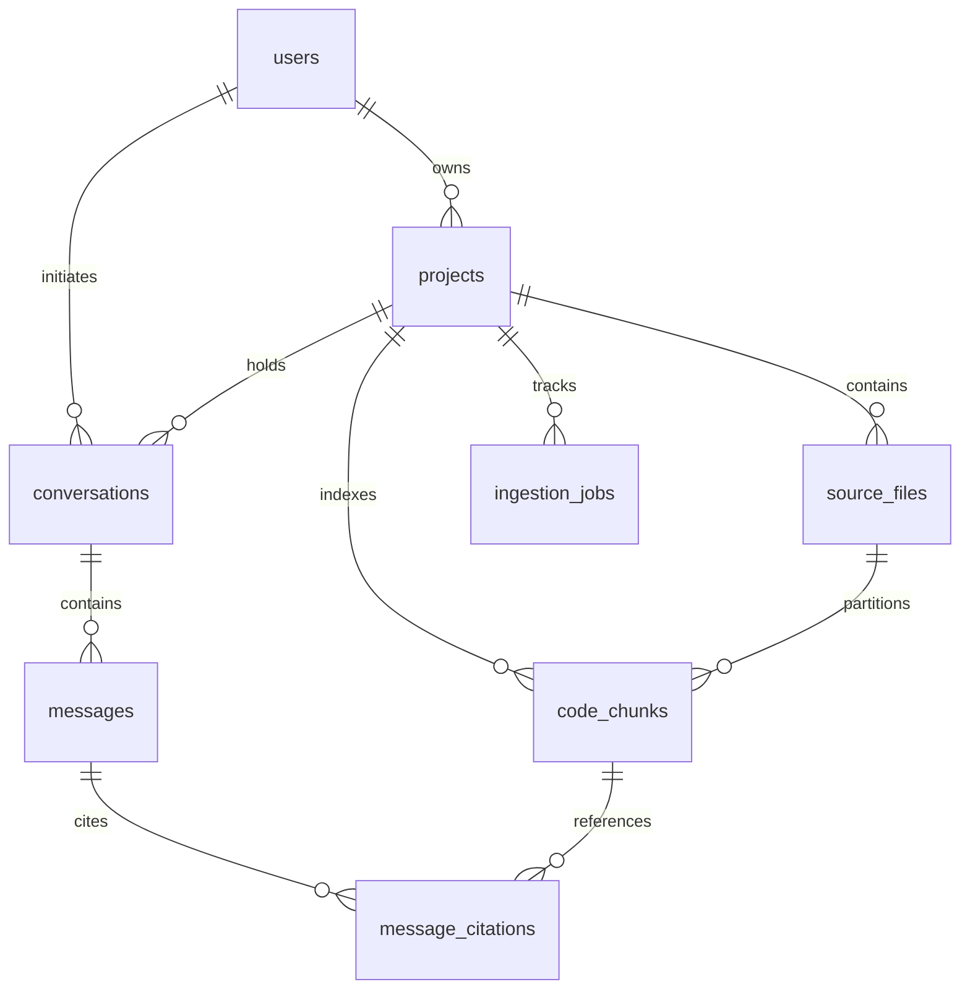

# Database Schema Documentation

Codebase Intelligence uses PostgreSQL 16 with the `pgvector` extension for storing application relational entities, vector embeddings, and full-text search indexes.

---

## 1. Entity Relationship Diagram



---

## 2. Table Definitions

### `users`
| Column | Type | Constraints | Description |
|---|---|---|---|
| `id` | UUID | PRIMARY KEY | Unique user identifier |
| `email` | VARCHAR(255) | UNIQUE, NOT NULL, INDEX | User email address |
| `password_hash` | VARCHAR(255) | NOT NULL | Bcrypt hashed password |
| `created_at` | TIMESTAMPTZ | NOT NULL | Account creation timestamp |

### `projects`
| Column | Type | Constraints | Description |
|---|---|---|---|
| `id` | UUID | PRIMARY KEY | Unique project identifier |
| `user_id` | UUID | FK -> `users.id` (ON DELETE CASCADE) | Owner identifier |
| `name` | VARCHAR(255) | NOT NULL | Project display name |
| `status` | VARCHAR(50) | NOT NULL, DEFAULT 'created' | State: created, processing, ready, failed |
| `created_at` | TIMESTAMPTZ | NOT NULL | Timestamp |
| `updated_at` | TIMESTAMPTZ | NOT NULL | Last modified timestamp |

### `source_files`
| Column | Type | Constraints | Description |
|---|---|---|---|
| `id` | UUID | PRIMARY KEY | File identifier |
| `project_id` | UUID | FK -> `projects.id` (ON DELETE CASCADE) | Project scope |
| `path` | VARCHAR(1024) | NOT NULL | Relative path within codebase |
| `language` | VARCHAR(50) | NOT NULL | Programming language identifier |
| `content_hash` | VARCHAR(64) | NOT NULL | SHA-256 of file text |
| `line_count` | INTEGER | NOT NULL, DEFAULT 0 | Total lines of code |
| `size_bytes` | INTEGER | NOT NULL, DEFAULT 0 | File size in bytes |
| `content` | TEXT | NOT NULL | Source code text for preview |
| `created_at` | TIMESTAMPTZ | NOT NULL | Creation timestamp |

### `code_chunks`
| Column | Type | Constraints | Description |
|---|---|---|---|
| `id` | UUID | PRIMARY KEY | Chunk identifier |
| `source_file_id` | UUID | FK -> `source_files.id` (ON DELETE CASCADE) | Parent file |
| `project_id` | UUID | FK -> `projects.id` (ON DELETE CASCADE) | Multi-tenant boundary |
| `content` | TEXT | NOT NULL | Code chunk text |
| `symbol_name` | VARCHAR(255) | NULLABLE | Function/class symbol name |
| `chunk_type` | VARCHAR(50) | NOT NULL | function, class, module, block |
| `start_line` | INTEGER | NOT NULL | 1-indexed starting line |
| `end_line` | INTEGER | NOT NULL | 1-indexed ending line |
| `content_hash` | VARCHAR(64) | NOT NULL | SHA-256 chunk hash |
| `embedding` | VECTOR(384) | NULLABLE | Dense vector embedding |
| `search_vector` | TSVECTOR | NULLABLE | PostgreSQL Full-Text search vector |

### `ingestion_jobs`
| Column | Type | Constraints | Description |
|---|---|---|---|
| `id` | UUID | PRIMARY KEY | Job identifier |
| `project_id` | UUID | FK -> `projects.id` (ON DELETE CASCADE) | Target project |
| `status` | VARCHAR(50) | NOT NULL | pending, processing, completed, failed |
| `processed_files` | INTEGER | NOT NULL, DEFAULT 0 | Progress counter |
| `total_files` | INTEGER | NOT NULL, DEFAULT 0 | Total files discovered |
| `error_message` | TEXT | NULLABLE | Ingestion error details if failed |
| `created_at` | TIMESTAMPTZ | NOT NULL | Start timestamp |
| `completed_at` | TIMESTAMPTZ | NULLABLE | Completion timestamp |

### `conversations`
| Column | Type | Constraints | Description |
|---|---|---|---|
| `id` | UUID | PRIMARY KEY | Conversation identifier |
| `project_id` | UUID | FK -> `projects.id` (ON DELETE CASCADE) | Project scope |
| `user_id` | UUID | FK -> `users.id` (ON DELETE CASCADE) | Initiating user |
| `title` | VARCHAR(255) | NOT NULL | Thread summary title |
| `created_at` | TIMESTAMPTZ | NOT NULL | Timestamp |

### `messages`
| Column | Type | Constraints | Description |
|---|---|---|---|
| `id` | UUID | PRIMARY KEY | Message identifier |
| `conversation_id` | UUID | FK -> `conversations.id` (ON DELETE CASCADE) | Parent conversation |
| `role` | VARCHAR(50) | NOT NULL | 'user' or 'assistant' |
| `content` | TEXT | NOT NULL | Message markdown text |
| `created_at` | TIMESTAMPTZ | NOT NULL | Timestamp |

### `message_citations`
| Column | Type | Constraints | Description |
|---|---|---|---|
| `id` | UUID | PRIMARY KEY | Citation identifier |
| `message_id` | UUID | FK -> `messages.id` (ON DELETE CASCADE) | Parent message |
| `chunk_id` | UUID | FK -> `code_chunks.id` (ON DELETE SET NULL) | Cited chunk |
| `file_path` | VARCHAR(1024) | NOT NULL | Relative path of cited file |
| `start_line` | INTEGER | NOT NULL | Starting line reference |
| `end_line` | INTEGER | NOT NULL | Ending line reference |
| `snippet` | TEXT | NULLABLE | Code excerpt preview |

---

## 3. Database Indexes

1. **Vector Index**:
   ```sql
   CREATE INDEX ix_code_chunks_embedding ON code_chunks
   USING hnsw (embedding vector_cosine_ops)
   WITH (m = 16, ef_construction = 64);
   ```
2. **Full-Text Search Index**:
   ```sql
   CREATE INDEX ix_code_chunks_search_vector ON code_chunks
   USING gin (search_vector);
   ```
3. **Compound Tenant Index**:
   ```sql
   CREATE INDEX ix_code_chunks_project_symbol ON code_chunks (project_id, symbol_name);
   CREATE UNIQUE INDEX ix_source_files_project_path ON source_files (project_id, path);
   ```
